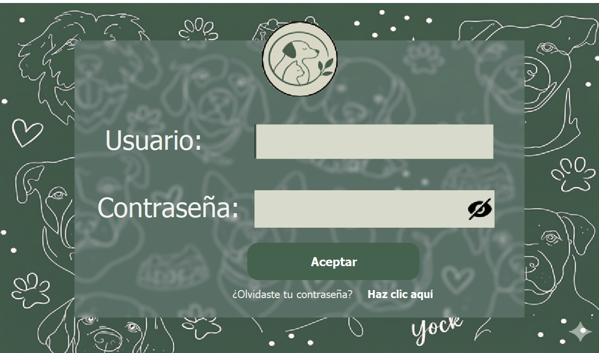
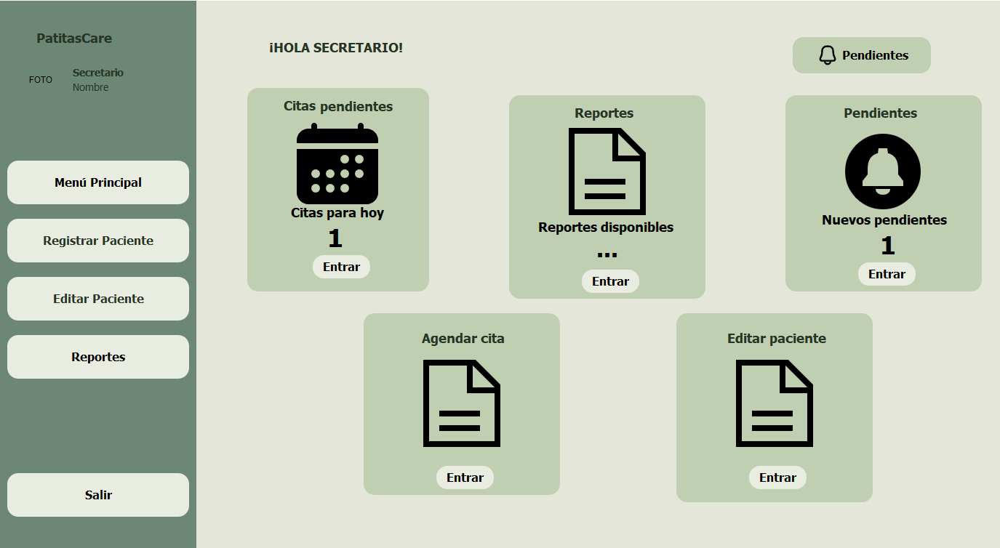
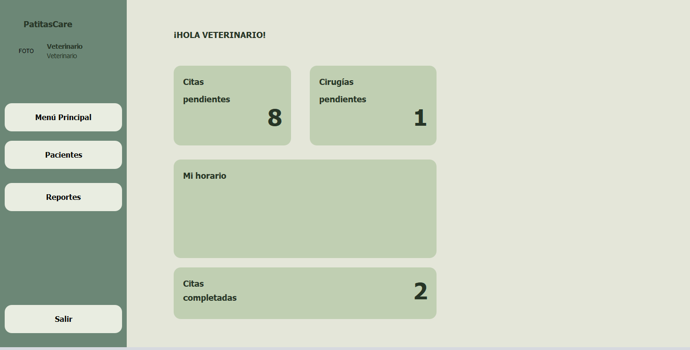

<!-- LOGO DEL PROYECTO -->
<p align="center">
  
</p>

<h1 align="center">Patitas Care</h1>

<p align="center">
  <strong>Plataforma integral para la gestión y cuidado de mascotas.</strong>
</p>

<!-- BANNER O VISTA PREVIA PRINCIPAL -->
<p align="center">
  
</p>


## 📌 Acerca del Proyecto

**Patitas Care** es una solución desarrollada para facilitar la administración, seguimiento y
control del bienestar animal. Permite organizar registros de salud, citas, vacunas y expedientes de mascotas de manera centralizada e intuitiva.

---

## ✨ Características Principales

- 🐶 **Gestión de Perfiles:** Registro individual de mascotas con datos clave, raza, edad e historial.
- 📅 **Control de Citas y Vacunas:** Agenda y recordatorios para visitas al veterinario y esquemas de vacunación.
- 📋 **Expediente Médico:** Historial clínico accesible y organizado por mascota.
- 🔍 **Búsqueda y Filtros:** Navegación rápida entre registros de pacientes/mascotas.

---

<!-- DIAGRAMA O CAPTURA DE CARACTERÍSTICA DESTACADA -->
<table align="center">
  <tr>
    <td align="center" valign="top">
      
    </td>
    <td align="center" valign="top">
          </td>
  </tr>
</table>

## 🛠️ Tecnologías Utilizadas

- **Frontend / UI:** Java
- **Backend:** Java
- **Base de Datos:** MariaDB
- **Herramientas de Diseño:** Krita

---

## 📁 Estructura del Proyecto

```text
Patitas_Care/
├── assets/          # Imágenes, iconos y recursos multimedia
├── docs/            # Documentación técnica de arquitectura y requerimientos
├── src/             # Código fuente principal de la aplicación
├── tests/           # Pruebas unitarias y de integración
├── .gitignore
├── LICENSE
└── README.md